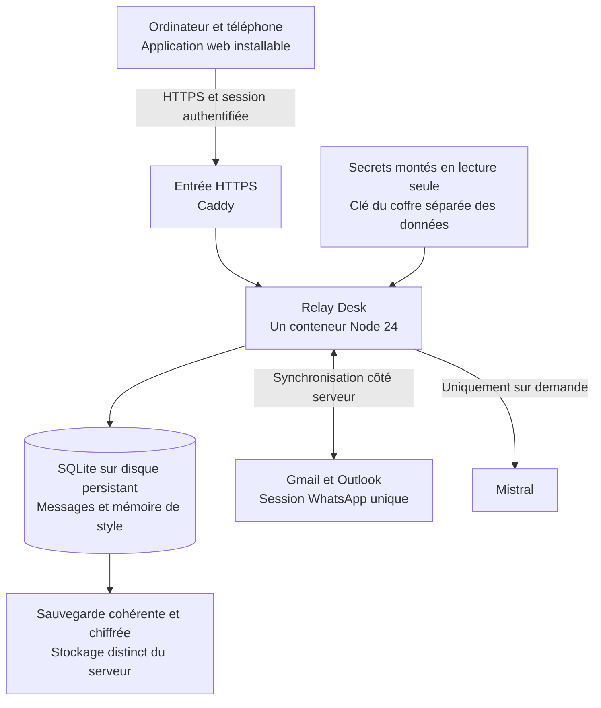

# Architecture hébergée et mobile de Relay Desk

Relay Desk tournera sur un serveur hébergé persistant et restera accessible lorsque le Mac est éteint. Une application web installable sur téléphone donnera accès aux mêmes comptes, messages, brouillons et propositions IA. L’application restera réservée à son propriétaire ; Anove, Personnel et les autres profils sont ses espaces de travail, pas des utilisateurs distincts.

Plan établi avec Claude le 19 octobre 2026. Les deux décisions confirmées sont l’hébergement indépendant du Mac et l’usage durablement personnel. Le choix du prestataire, du domaine et du budget reste à fixer avant le déploiement.

## État de réalisation

Les lots 1, 2 et 3 sont implémentés et vérifiés avec des données fictives. Keycloak a été choisi pour la future identité du propriétaire ; l’application exige l’émetteur, le sujet stable et le niveau MFA configurés explicitement. Le serveur Keycloak réel, son client et l’identité du propriétaire ne sont pas encore configurés. Les tests OIDC emploient des jetons signés et un émetteur simulé ; aucun déploiement ni transfert de données réelles n’a été effectué. Les configurations et limites actuelles sont détaillées dans `docs/auth.md` et `docs/docker.md`.

## Architecture retenue

Le serveur conserve le monolithe modulaire existant : HTTP, services de messagerie, adaptateurs et tâches de synchronisation partagent un processus. Il y aura un seul runtime actif pour la base et les sessions WhatsApp. Docker Compose gérera le conteneur applicatif et l’entrée HTTPS ; un mécanisme séparé exécutera les sauvegardes.

SQLite reste adapté à cette instance personnelle, avec un volume sur un système de fichiers local au serveur. Son mode WAL ne fonctionne pas sur un système de fichiers réseau partagé. Une base managée et des services distribués ne sont donc pas nécessaires pour cette cible. [Contraintes SQLite WAL](https://www.sqlite.org/wal.html).

La synchronisation s’exécutera sur le serveur, indépendamment de l’état du navigateur et du téléphone. Les connecteurs et les jetons resteront côté serveur. Les copies de messages et la mémoire de style qui étaient sur le Mac seront désormais privées sur ce serveur ; les libellés « Sur ce Mac » seront adaptés.

## Écarts avec le code actuel

| Point | État actuel | Évolution nécessaire |
| --- | --- | --- |
| Démarrage | `server.js` assemble HTTP, données et connecteurs et les démarre ensemble | Configuration validée, cycle de vie explicite, démarrage et arrêt contrôlés |
| Accès | Écoute locale et liste de Host limitée à localhost, sans connexion utilisateur | Authentification du propriétaire, HTTPS et contrôle des requêtes |
| Autorisations email | Clients bureau et retours Google/Entra sur loopback | Mode hébergé avec clients Web et retours HTTPS fixes |
| Données | SQLite WAL, clé générée par défaut dans `data/secret.key` | Volume persistant et clé fournie séparément, jamais régénérée silencieusement en hébergement |
| Interface | Trois colonnes pensées pour ordinateur | Navigation mobile liste → conversation → réponse, assistant plein écran |
| Transport | `/api/state` renvoie tous les profils ; fil WhatsApp complet chargé à la demande | Listes et historiques paginés, contexte IA toujours construit côté serveur |
| Envoi | Aperçu à durée limitée et validation à usage unique en mémoire | Même parcours, lié aussi à la session authentifiée ; traitement des résultats incertains après interruption |
| Distribution | Aucun Dockerfile, manifeste PWA ou service worker | Image reproductible, Compose et installation web mobile |

## Lots de réalisation

### Lot 1 Configuration et cycle de vie

Extraire la configuration et l’assemblage du runtime de `server.js`. Garder un mode local et ajouter un mode hébergé explicite. Centraliser l’URL publique, les hôtes autorisés, le répertoire de données et la lecture des secrets depuis des fichiers. Le mode hébergé devra refuser une configuration incomplète plutôt qu’assouplir les protections locales.

Créer un démarrage ordonné : migrations, contrôle de la clé, acquisition du verrou d’instance, initialisation des connecteurs, puis disponibilité HTTP. Un arrêt normal fermera les connexions et sauvegardera les identifiants sans déconnecter WhatsApp du téléphone. Les envois en cours seront drainés ou signalés comme incertains.

**Validation :** les tests existants restent verts ; démarrage avec configuration invalide refusé ; redémarrage sans perte des données ni des identités de mémoire ; une seconde instance sur le même volume ne démarre pas.

**Fichiers prévus :** `server.js`, `src/runtime/config.js`, `src/runtime/lifecycle.js`, `src/secrets.js`, tests de configuration et de cycle de vie.

### Lot 2 Image Docker et stockage persistant

Préparer une image Linux Node 24 avec dépendances verrouillées, utilisateur non root et arrêt propre sur SIGTERM. Exclure explicitement du contexte de construction `.env`, `data/`, sauvegardes, exports, archives de transfert et fichiers locaux. Ne jamais copier tout le poste dans l’image.

Ajouter un Compose de développement lié à l’interface locale et un Compose hébergé dans lequel seul le proxy HTTPS publie les ports d’accès. Le conteneur applicatif aura un système de fichiers en lecture seule, un volume de données inscriptible et un répertoire temporaire dédié. Le réseau autorisera les connexions sortantes nécessaires aux fournisseurs.

La clé du coffre et les secrets OAuth/Mistral seront montés en lecture seule. Les secrets Compose sont des fichiers montés et ne constituent pas, à eux seuls, du chiffrement du disque hôte. Les permissions du compte de service et les sauvegardes des clés feront partie de la configuration. [Secrets Docker Compose](https://docs.docker.com/compose/how-tos/use-secrets/).

**Validation :** construction et tests sur Linux ; image sans données ni secrets ; UID non root ; données et authentifications conservées après remplacement du conteneur ; sauvegarde restaurable avec la clé correspondante. Le statut `unhealthy` sera supervisé : un healthcheck ne remplace pas une politique de reprise.

**Fichiers prévus :** `Dockerfile`, `.dockerignore`, `compose.yaml`, surcharge de développement et `deploy/Caddyfile`.

### Lot 3 Authentification du propriétaire et API hébergée

Ajouter une connexion à Relay Desk distincte de l’autorisation d’accès à Gmail ou Outlook. Retenir un fournisseur OIDC éprouvé avec MFA et un unique propriétaire autorisé, identifié par le couple émetteur et sujet stable. Le choix du compte d’identité personnel sera fixé avant la configuration ; aucune inscription publique ni gestion multi-utilisateur n’est prévue.

Utiliser des sessions serveur avec cookies Secure, HttpOnly et SameSite adaptés au retour OAuth. Protéger les mutations avec un jeton CSRF et la vérification de l’origine. Configurer les hôtes autorisés et les proxys de confiance à partir de paramètres fixes, sans dériver les URL de retour d’un en-tête client arbitraire. Les sessions par appareil devront être révocables. La limitation de débit sera appliquée aux points d’entrée sensibles côté application ; elle n’est pas supposée fournie par défaut par Caddy.

L’aperçu d’envoi sera lié au compte, à la conversation, au contenu exact, à la génération et à la session authentifiée. Aucun double clic, rafraîchissement ou rejeu ne devra envoyer deux fois. Une interruption après appel fournisseur ne déclenchera jamais une retransmission automatique. Les changements sensibles de connexion ou de secrets pourront exiger une authentification récente ; l’usage quotidien conservera le parcours aperçu puis validation.

**Validation :** API, QR et contenus inaccessibles sans connexion ; accès refusé à une autre identité ; tests CSRF, origine, session expirée et révocation appareil ; aucun secret ni code OAuth dans les journaux.

**Fichiers prévus :** `src/auth/`, `src/http/app.js`, `src/mail/`, adaptateurs d’envoi et tests d’accès.

### Lot 4 Connexions Gmail et Outlook depuis le serveur

Conserver les flux bureau pour le développement local et ajouter les flux Web pour l’hébergement. Les retours seront construits à partir de l’URL publique configurée, avec HTTPS et correspondance exacte aux URI déclarées. Un `localhost` ouvert depuis un téléphone ne désigne pas le serveur hébergé. [Google OAuth Web](https://developers.google.com/identity/protocols/oauth2/web-server), [plateformes et URI Microsoft](https://learn.microsoft.com/entra/identity-platform/how-to-add-redirect-uri).

Garder PKCE et lier chaque état OAuth à la session propriétaire, au profil visé, au fournisseur et à la durée de validité. Les secrets de clients Web restent sur le serveur. Une reconnexion au nouveau client devra vérifier l’adresse et conserver l’identifiant du compte, les messages, les brouillons et la mémoire ; elle ne devra pas créer une boîte dupliquée.

Contrôler le statut réel de l’application Google, ses portées Gmail et les exigences liées à l’usage hébergé. L’usage personnel peut relever d’exceptions à la vérification, mais le statut de publication, les limites d’accès et une éventuelle évaluation des portées restreintes restent à vérifier pour la configuration retenue. Le passage en production ne garantit pas l’absence future de réautorisation. [Vérification des portées restreintes et exceptions](https://developers.google.com/identity/protocols/oauth2/production-readiness/restricted-scope-verification).

**Validation :** connexion et reconnexion depuis ordinateur puis mobile ; retour vers le bon profil ; refresh après redémarrage ; refus des états expirés, rejoués ou issus d’une autre session. Les nouveaux clients ne réutiliseront pas par hypothèse les jetons attachés aux anciens clients bureau.

**Fichiers prévus :** `src/providers/gmail/oauth.js`, `src/providers/outlook/oauth.js`, runtime, routes OAuth et documentation de configuration.

### Lot 5 Interface mobile et PWA

Adapter l’interface existante à une navigation tactile à un écran : liste des conversations, lecture, rédaction, assistant. Prévoir le bouton retour, le clavier mobile, les zones de sécurité de l’écran et le compositeur fixe. Ajouter la pagination des listes et de l’historique, sans supprimer les messages stockés ni réduire artificiellement le contexte utilisable par l’IA.

Ajouter un manifeste et les icônes pour l’installation depuis le navigateur. L’installation web hors développement exige HTTPS. Le navigateur pourra mettre en cache les ressources statiques versionnées ; les réponses API, messages, brouillons, exemples de mémoire, QR et retours OAuth ne seront pas mis en cache par le service worker. [Installation des PWA](https://developer.mozilla.org/en-US/docs/Web/Progressive_web_apps/Guides/Making_PWAs_installable).

Les brouillons seront sauvegardés sur le serveur pendant la connexion, avec version pour éviter qu’un téléphone et un ordinateur s’écrasent mutuellement. Une perte de réseau affichera l’état non enregistré. Aucun envoi hors ligne, mécanisme Background Sync du navigateur ou file d’envoi automatique n’est prévu. Un aperçu ou un envoi hors ligne échouera explicitement et ne sera pas rejoué au retour du réseau. Le contexte de génération restera construit côté serveur ; la proposition sera périmée si le fil ou la mémoire change.

Le QR WhatsApp pourra être affiché dans la session Relay Desk sur ordinateur et scanné par le téléphone. L’activation de notifications sera un complément après la première version mobile ; elle devra être testée sur les appareils réels et utiliser par défaut un contenu générique sans extrait de message.

**Validation :** Safari sur iPhone et Chrome sur Android réels ; installation, reprise après fermeture, clavier, navigation, session expirée, perte et retour réseau ; brouillons concurrents détectés ; aperçu exact lisible et confirmation distincte. L’appareil mobile n’exécutera pas les tâches de synchronisation du serveur.

**Fichiers prévus :** `public/index.html`, `public/styles.css`, `public/js/`, manifeste, icônes et service worker.

### Lot 6 Exploitation du serveur

Choisir une VM Linux persistante, sa région, son domaine et le dimensionnement après mesure de la consommation d’un import historique WhatsApp. Docker Compose convient à une instance personnelle disponible en continu. Le domaine et les DNS permettront la terminaison HTTPS avec renouvellement des certificats par Caddy. [HTTPS automatique Caddy](https://caddyserver.com/docs/automatic-https). L’accès d’administration sera séparé de l’accès à l’application.

Préparer les sauvegardes cohérentes de SQLite, leur chiffrement et leur stockage hors de la VM. Conserver la clé de restauration par un autre chemin sécurisé. Utiliser une sauvegarde SQLite cohérente, plutôt qu’une simple copie de `relay.db` pendant que WAL est actif. [API de sauvegarde SQLite](https://www.sqlite.org/backup.html). Tester une restauration complète incluant les messages, les identités de mémoire et le déchiffrement des jetons. Le parcours de restauration laissera les connecteurs arrêtés ; en particulier, une ancienne session WhatsApp ne sera jamais réactivée automatiquement à partir d’une sauvegarde. Sa reprise exigera une action explicite et pourra nécessiter une nouvelle liaison QR.

Prévoir une supervision sobre : disponibilité, erreurs de synchronisation, comptes à reconnecter, espace disque et âge de la dernière sauvegarde. Une déconnexion d’un fournisseur ne devra pas rendre toute l’application indisponible. Distinguer la santé du processus, l’accès à la base et l’état de chaque connecteur. Les journaux contiendront des identifiants techniques et des erreurs assainies, jamais les corps de messages, QR ou jetons.

**Validation :** instance vide sécurisée accessible en HTTPS ; reprise après arrêt du conteneur et redémarrage de la VM ; restauration testée ; procédure de mise à jour et retour arrière tenant compte des migrations. La disponibilité permanente reste un objectif d’exploitation, pas une promesse de haute disponibilité à plusieurs serveurs.

**Fichiers prévus :** configuration de déploiement, outils de sauvegarde/restauration, contrôles de santé et guide d’exploitation.

### Lot 7 Migration du Mac et recette réelle

Commencer avec le serveur sécurisé et des données fictives. Avant la bascule réelle, arrêter la synchronisation du Mac et désactiver explicitement sa reprise automatique pour éviter deux instances de la même session WhatsApp. Produire une sauvegarde cohérente, chiffrée, puis transférer les données et la clé séparément vers l’hébergement choisi.

Restaurer d’abord avec les connecteurs arrêtés. Vérifier les profils, les adresses des comptes, les nombres de conversations, les brouillons et la mémoire sans exporter le contenu dans les journaux. Les brouillons seront conservés ; les validations d’envoi anciennes seront invalidées.

Reconnecter Gmail et Outlook avec les clients Web en conservant les données. Pour WhatsApp, privilégier une nouvelle liaison QR sur le serveur avec le même numéro et le parcours qui conserve le compte et ses données. L’ancienne instance sera neutralisée avant cette liaison. La compatibilité du connecteur communautaire sera vérifiée sur le serveur choisi ; aucune reprise d’une ancienne copie de ses clés ne sera supposée sûre après utilisation sur un autre hôte.

**Validation :** Mac éteint, nouveaux messages Gmail/Outlook/WhatsApp reçus sur le serveur puis visibles sur téléphone ; mémoire et brouillons présents ; aucune duplication de compte ou de session. Les essais d’envoi réels resteront soumis à un aperçu précis et à la validation du propriétaire. En cas de retour au Mac, arrêter le serveur et rétablir une seule instance, avec une reliaison WhatsApp si nécessaire. Aucun envoi au résultat incertain ne sera rejoué depuis une ancienne sauvegarde.

## Ordre de travail et livrables

Les lots 1 et 2 donnent un paquet reproductible en local. Le lot 3 est terminé avant toute exposition de données à distance. La configuration du domaine permet le lot 4 ; l’interface du lot 5 peut être préparée en parallèle sur des données fictives. Le lot 6 fournit un environnement de réception sécurisé et restaurable. Le lot 7 n’intervient qu’après validation des parcours précédents.

L’ordre de recette sera : lots 1 → 2 → 3 → 6 sur base vide → 4 → 5 → 7. La préparation de l’interface mobile pourra avancer pendant les autres lots ; le domaine hébergé devra exister avant la recette OAuth Web complète.

Le premier livrable de développement sera donc **la configuration hébergée et le conteneur reproductible**, avec la base de test persistante, les secrets externes à l’image et les tests de redémarrage. Aucune donnée réelle n’a besoin de quitter le Mac pour réaliser ce premier lot.

Les limites fonctionnelles déjà présentes restent visibles : groupes WhatsApp en lecture/IA, médias exclus et disponibilité de l’historique dépendante du téléphone. Le passage à Docker et au mobile ne change pas ces capacités à lui seul.
